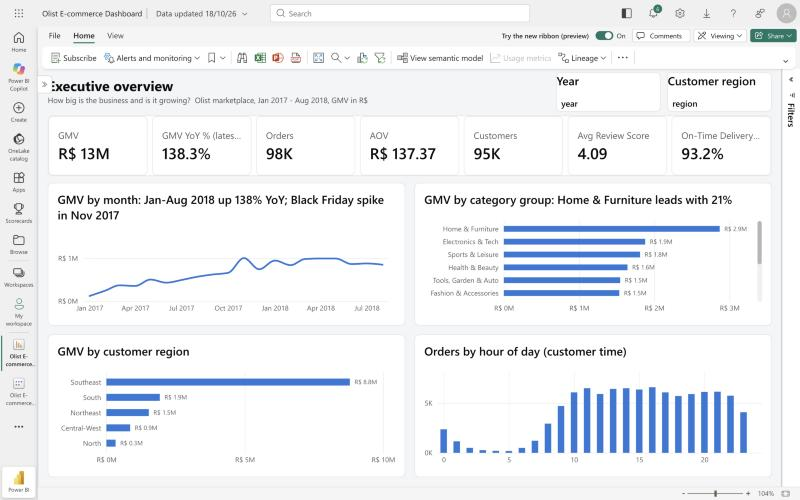
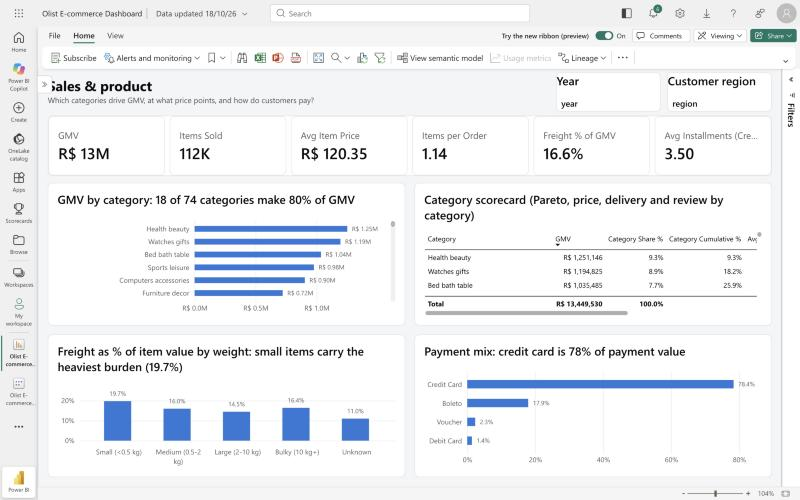
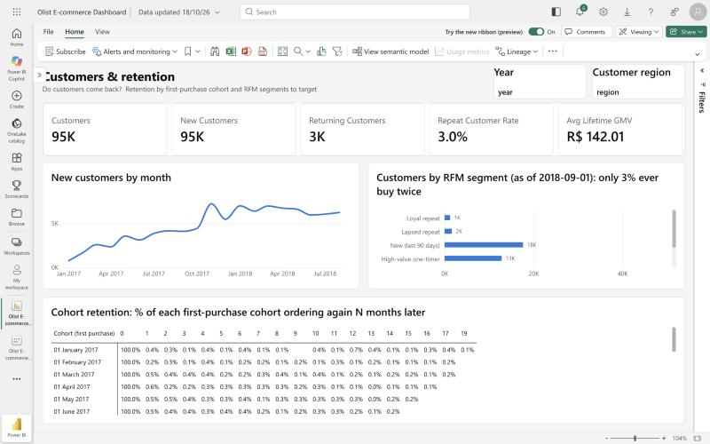
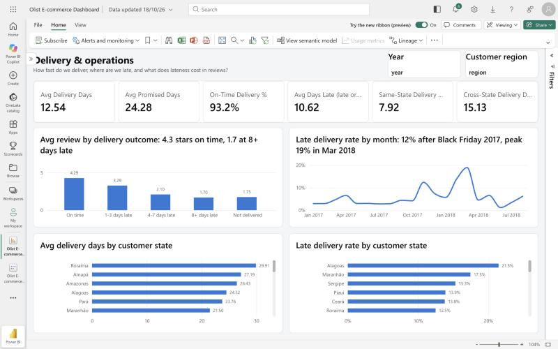
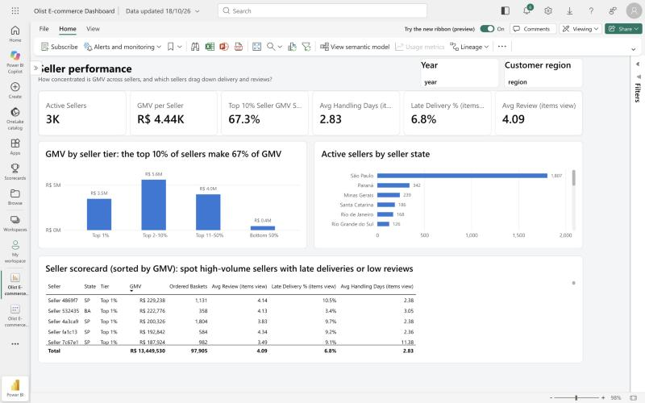

# E-commerce Performance Dashboard (Power BI)

A 5-page Power BI dashboard for a marketplace e-commerce business, built the way an in-house data analyst
would. I cleaned the raw order data into a star schema and defined every KPI once in a DAX semantic model.
Every headline number is reconciled against an independent pandas calculation. Each report page then answers
a different stakeholder's questions.

**Data:** [Olist Brazilian E-Commerce Public Dataset](https://www.kaggle.com/datasets/olistbr/brazilian-ecommerce)
(real, anonymised marketplace orders from Olist; CC BY-NC-SA 4.0). Window: Jan 2017 to Aug 2018 (20 full months),
covering 97.9k orders, 111.8k items, 94.7k customers and 3,029 sellers. Currency: Brazilian real (R$).



## Use cases (one report page each)

| Page | Stakeholder | Questions it answers |
|---|---|---|
| 1. Executive overview | Leadership | How big is the business and is it growing? GMV, orders, AOV, customers, review score, on-time rate, trend, YoY |
| 2. Sales & product | Category / merchandising | Which categories drive GMV (Pareto)? Price points, freight burden by product weight, payment mix |
| 3. Customers & retention | Marketing / CRM | Do customers come back? New vs returning, cohort retention matrix, RFM segments to target |
| 4. Delivery & operations | Ops / logistics | How fast do we deliver, where are we late, and what does lateness cost in reviews? |
| 5. Seller performance | Marketplace / partner team | How concentrated is GMV across sellers, and which big sellers deliver late or review poorly? |

Every page has Year and Customer-region slicers.

## Key findings

| Area | Finding |
|---|---|
| Growth | **R$13.45M GMV** from 97.9k orders, **AOV R$137**. GMV for Jan-Aug 2018 is **+138% YoY** (R$7.34M vs R$3.08M) |
| Seasonality | Black Friday 2017 (Nov 24) had **1,166 orders in one day**, the single biggest spike in the window |
| **Delivery drives reviews** | 6.8% of orders arrive after the promised date. Reviews average **4.29 stars on time, 3.29 at 1-3 days late, 2.10 at 4-7 days late and 1.70 at 8+ days late**. 61% of late orders get 1-2 stars (vs 9% on time) |
| Late-delivery spikes | The late rate jumped from ~3-4% to **12.4% in Nov 2017** (Black Friday volume) and peaked at **19.0% in Mar 2018** |
| Geography | Deliveries take 12.5 days on average against a 24.3-day promise. North and Northeast customers wait 20-23 days, and the Northeast has the highest late rate (12.8%). Same-state orders arrive in 7.9 days vs 15.1 cross-state |
| **Almost no repeat buyers** | Only **3.0%** of customers ever order twice, and they bring 5.6% of GMV. Month-1 cohort retention is under 1%. Growth is pure acquisition |
| Seller concentration | The **top 10% of sellers make 67% of GMV**; the bottom half make 3% |
| Freight | Freight is 16.6% of item value overall but **19.7% on small items (<0.5 kg)**, because shipping has a floor that cheap items can't absorb |
| Payments | Credit cards carry 78% of payment value, and 67% of card payments are split into 2+ installments (avg 3.5) |
| Categories | 18 of 74 categories make 80% of GMV. Home & Furniture is the largest group (21%) |

### Recommendations (my analysis, based on the findings above)

1. **Fix delivery before buying more traffic.** Each late order costs about 2 stars. Use the seller scorecard to
   flag high-GMV sellers with late rates above 10%, and pad the delivery promise for Northeast and North routes.
2. **Plan peak capacity.** Late deliveries tripled after Black Friday 2017. Pre-book carrier capacity for
   Nov-Mar and staff seller onboarding before the peak.
3. **Start a retention program.** With 97% one-time buyers, even a small lift in repeat rate is material.
   Target the 12.8k "High-value one-timer" segment first.
4. **Bundle small items.** A free-shipping threshold or "add-on" items would spread the 19.7% freight burden.

## Screenshots

| | |
|---|---|
|  |  |
|  |  |

## How it's built

```
Olist raw CSVs (9 tables, Kaggle)
  └─ pipeline/build_model.py ── clean, conform, integer surrogate keys, sort-order columns, FK checks
       └─ data/model/*.csv   ── 7-table star schema, published in this repo
            │                   (Power BI reads the raw GitHub URLs over HTTPS, anonymous, so refresh needs no gateway)
            └─ Power BI semantic model "Olist E-commerce Performance" (Import)
                 ├─ powerbi/model_full.tmdl ── tables, typed M partitions, 6 relationships, 62 DAX measures
                 │                             (generated from powerbi/measures.dax by gen_tmdl.py)
                 └─ Report "Olist E-commerce Dashboard" ── powerbi/report/ (PBIR, generated by gen_report.py,
                                                          published with the Fabric REST API)
pipeline/reference_kpis.py ── independent pandas numbers; docs/reconciliation.md = 30/30 DAX checks match
```

The whole model and report are **code**. `measures.dax` is the single source of truth for every KPI, and the
report layout, titles and theme are generated, so the dashboard can be rebuilt or reviewed in a pull request.

### Star schema

| Table | Grain | Notes |
|---|---|---|
| `fct_orders` | order | status, delivery timings, late flag, delivery outcome, review score, payment summary, customer order sequence |
| `fct_order_items` | order line | price, freight; non-cancelled orders only (GMV lives here) |
| `fct_payments` | payment record | type, installments, value (an order can mix card and voucher) |
| `dim_customer` | person (`customer_unique_id`) | state, region, cohort month, lifetime GMV, RFM segment |
| `dim_product` | product | English category, 10 category groups, weight band |
| `dim_seller` | seller | state, region, GMV tier (Top 1% / 2-10% / 11-50% / Bottom 50%) |
| `dim_date` | day | calendar, marked as the date table |

Relationships are single-direction and many-to-one. `fct_order_items` reaches dates and customers through
`fct_orders`, which avoids ambiguous filter paths. Seller- and category-level delivery and review measures use
`CROSSFILTER` inside the measure rather than a bidirectional relationship.

### Definitions

- **GMV** = sum of item price on non-cancelled orders (cancelled and unavailable excluded). Freight is reported separately.
- **Late** = delivered on a later calendar day than the estimated delivery date (delivered orders only).
- **Repeat customer** = 2+ non-cancelled orders in the window, keyed on `customer_unique_id` (Olist issues a new `customer_id` per order).
- **YoY** returns blank unless the full prior-year period is in the data, so an all-years view never compares 20 months against 8. The KPI card shows the latest year.
- **RFM segment** (as of 2018-09-01): Loyal repeat, Lapsed repeat, New (last 90 days), High-value one-timer, One-timer cooling, Dormant (1 yr+).

### Validation

`docs/reconciliation.md` compares 30 DAX results from the live model with the pandas reference, and all 30 match
to 4 decimals. The reconciliation also caught a real bug: in DAX `BLANK = 0` is TRUE, so `is_late = 0` counted
undelivered orders as "on time" (4.21 vs 4.29 stars). The fix was strict equality (`==`).

## Reproduce

```bash
# 1. put the Kaggle CSVs in data/raw/
python3 pipeline/build_model.py       # -> data/model/*.csv
python3 pipeline/reference_kpis.py    # -> docs/reference_kpis.json
python3 powerbi/gen_tmdl.py --full    # -> powerbi/model_full.tmdl (paste into Power BI TMDL view, then refresh)
python3 powerbi/gen_report.py         # -> powerbi/report/ (PBIR; publish via Fabric "Create Report" API or open in Desktop)
```

## Repository layout

```
pipeline/     build_model.py, reference_kpis.py
data/model/   star-schema CSVs (the Power BI source)
powerbi/      measures.dax (source of truth), gen_tmdl.py, model*.tmdl, gen_report.py, report/ (PBIR)
docs/         reconciliation.md, reference_kpis.json, screenshots/
```

*Dataset: Olist, "Brazilian E-Commerce Public Dataset by Olist", Kaggle, CC BY-NC-SA 4.0. This repository is a
non-commercial portfolio project.*
